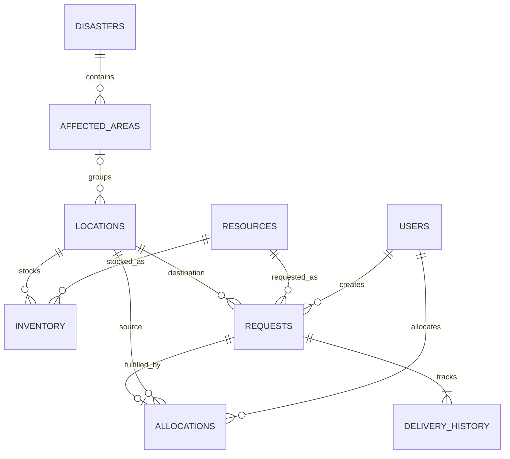

# System design

## Problem, objectives, and scope

A disaster can change demand faster than administrators can manually re-rank relief requests. The system combines a prioritized request queue, location-specific stock, shipment tracking, and field reporting. Its objectives are to keep allocation atomic, enforce lifecycle transitions in MySQL, and surface committed changes to administrators.

Each request represents one resource and one destination camp. One source fulfills the full quantity. The source is debited on allocation, and the destination is credited once upon confirmation. Inventory views show on-hand stock. Allocated shipments are visible in the delivery tracker. The workspace supports administrators.

## ER diagram

## Relational schema and data dictionary

| Relation | Primary key | Foreign keys and key attributes |
| --- | --- | --- |
| users | id | Unique email, salted password hash, admin or volunteer role. A null role marks a retired account retained for history. |
| disasters | id | Unique name, severity 1–5 |
| affected_areas | id | disaster_id; name unique per disaster |
| locations | id | area_id for camps; unique name, kind, population ≥ 0 |
| resources | id | Unique name, unit |
| inventory | location_id, resource_id | Both key columns are foreign keys; quantity and threshold ≥ 0 |
| requests | id | camp_id, resource_id, created_by; positive quantity, urgency 1–5, priority 0–100, lifecycle state, critical flag and creation time |
| allocations | id | Unique request_id, source_id, allocated_by, allocation time |
| delivery_history | id | request_id, state and transition time |
| notifications | id | event_type, JSON payload, creation and publication timestamps |

### Normalization

Operational relationships use atomic values and separate entities. In inventory, quantity and threshold depend on both parts of the composite key. Disaster metadata, camp names, and resource units live in their own relations and appear in requests and inventory through joins. Allocation quantity is derived from its immutable request. The stored priority is a derived operational value maintained by the recalculation procedure. The notification outbox intentionally stores a JSON snapshot for each event.

## Priority and allocation

`recalculate_priority(request_id, camp_id, resource_id, disaster_id)` applies every supplied filter. NULL omits a filter. It updates active requests in the caller’s transaction and emits a `priority_updated` notification via trigger for each changed score. It returns no result set. Read `request_details` for the resulting scores. The score is capped at 100.

| Factor | Points |
| --- | --- |
| Disaster severity | Severity × 6 |
| Camp population | Floor(population ÷ 10), capped at 30 |
| Request urgency | Urgency × 5 |
| Global on-hand shortage | Floor(15 × max(0, 1 − on-hand stock ÷ request quantity)) |

The demo starts with severity 5, population 80, urgency 5, 100 L on hand, and demand for 200 L. The components are 30 + 8 + 25 + 7 = 70. A report of 300 affected residents raises the population factor from 8 to 30 and the total from 70 to 92.

`allocate_request(request_id, source_id, actor_id)` owns its transaction. It locks the request, debits stock through a guarded update, records the allocation and state change, recalculates affected priorities, and commits before returning the allocation ID. Any SQL error rolls back the transaction. HTTP handlers call it outside their own transaction and retry transient deadlocks.

## Views, indexes, and analytical queries

- `stock_by_location` joins stock, location, and resource; `stock_totals` aggregates on-hand quantities.
- Distribution uses joins and grouping by disaster and resource. Shortage analytics use `GROUP BY` and `HAVING`. Unattended analytics use a correlated `NOT EXISTS` subquery and ordered results.
- The outbox index supports lookup of pending committed notifications. MongoDB has separate indexes for the report filters and text search.

